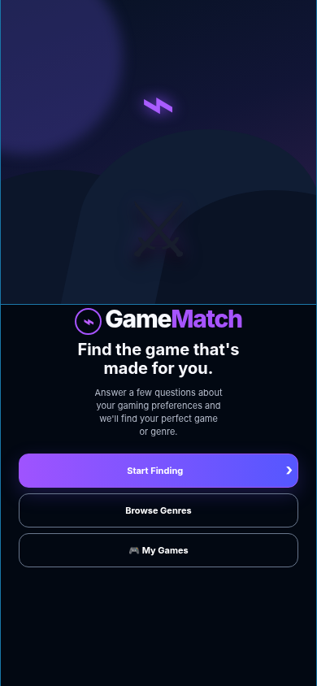
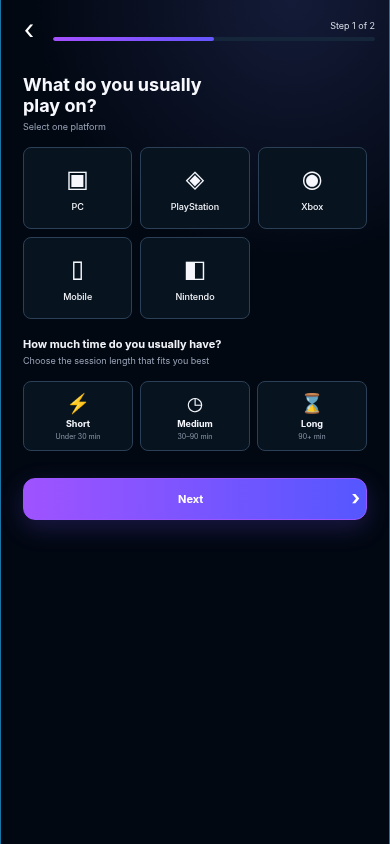
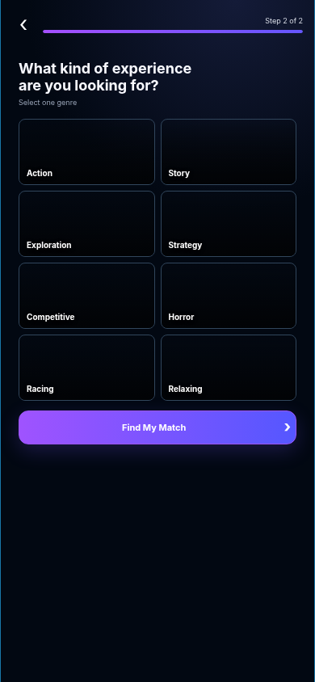
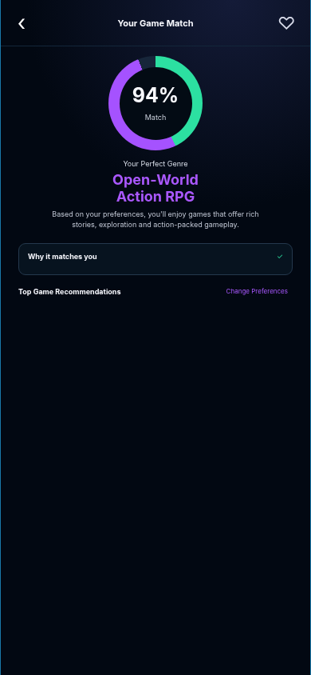
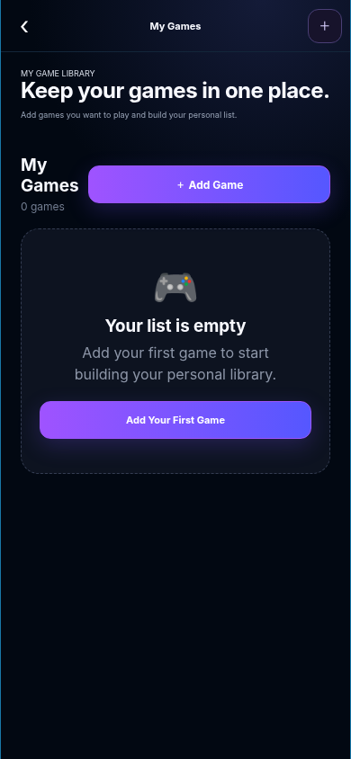

# GameMatch — SWYNEX App Development Internship

GameMatch is a polished, mobile-first game discovery and personal library web app built with **HTML, CSS and vanilla JavaScript**. It combines the recommendation flow from Task 2 with the create-and-list library feature from Task 3.

## Task 4 — Polish & Documentation

This version includes the final polish pass requested for Task 4:

- Refined mobile-first UI and consistent visual styling
- Clear selection, validation, empty, saved and error states
- Responsive layout for phone and desktop-sized viewports
- Accessible button labels and focus states
- App screenshots included below
- Local setup instructions
- Short demo walkthrough for reviewers

## Core Features

### Game discovery
- Choose **one platform** (PC, PlayStation, Xbox, Mobile or Nintendo)
- Choose a gaming session length
- Choose **one playstyle/genre**
- Strict platform filtering so recommendations only come from games available on the selected device
- Match score and **Why it matches you** explanation
- Game details, artwork and save/unsave actions

### My Games — Task 3 feature
- Create a personal game-library item
- Required-field and duplicate-game validation
- Helpful inline error messages
- Empty state when the library has no games
- List created games
- Remove games
- Persist library data with `localStorage`
- Optional notes and session-time fields

## Setup / Run Locally

### Option 1 — Open directly
1. Download or clone the repository.
2. Open `index.html` in a modern browser.
3. No framework, package manager or build step is required.

### Option 2 — Local server
From the project folder, run:

```bash
python -m http.server 8000
```

Then open `http://localhost:8000` in your browser.

## Demo Note

**Recommended 60–90 second demo:**

1. Start GameMatch and choose a platform, session length and playstyle.
2. Show that recommendations respect the selected device.
3. Open a recommendation and point out the match score and **Why it matches you** section.
4. Open **My Games** from the home screen.
5. Show the empty state, add a game, trigger validation once, then successfully create the game.
6. Refresh the page to demonstrate persistence, then remove the game.

## Screenshots

### Welcome


### Platform & session selection


### Playstyle selection


### Game match


### My Games


## Technology

- HTML5
- CSS3
- Vanilla JavaScript
- Browser `localStorage`

## Project Structure

```text
GameMatch/
├── index.html
├── style.css
├── script.js
├── README.md
└── screenshots/
    ├── welcome.png
    ├── preferences.png
    ├── playstyle.png
    ├── match.png
    └── library.png
```

## Demo / Submission

The project is self-contained and can be reviewed directly from the GitHub repository. The app does not claim React Native or Flutter; it is intentionally implemented as a mobile-responsive web app using HTML, CSS and JavaScript.
